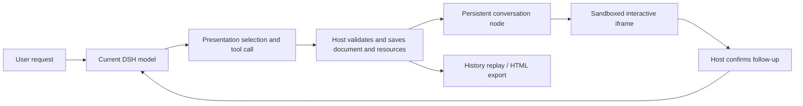

<div align="center">

# DSH Intelligent UI

**Turn an AI answer into something you can interact with.**

Create calculators, charts, maps, simulations and small applications inside DeepSeek Harness.<br />
Describe an idea, interact with the result, replay it later, and bring questions back to the conversation.

[](LICENSE)
[](#compatibility)
[](#quick-start)
[](docs/architecture.md)
[](#standalone-mcp)

[中文](README.md) · **English**

[Quick start](#quick-start) · [Examples](#use-it-in-a-conversation) · [Tools](#tools) · [FAQ](#faq) · [Development](#development-and-contributing)

</div>

---

## Why use it?

Some questions need a short explanation. Others become easier to understand when you can adjust a parameter, compare options, or watch a process unfold.

DSH Intelligent UI handles those interactive presentations. Your current DSH model calls tools to create a document; the plugin validates, renders and saves it. Buttons can include current values in a follow-up question and, after your confirmation, send it back to the original conversation.

**No orders, sales data or business database is required.** Formulas, user-provided data, clearly labelled synthetic data, places and educational explanations are all valid inputs. Real data must still come from your existing sources or DSH tools.

| What you want to do | What you can create | Try asking |
| --- | --- | --- |
| Understand a principle | Parameters, animation and formulas | “Explain a pendulum with an adjustable length.” |
| Compare options | Comparison cards or an interactive calculator | “Build a cost calculator for these three plans.” |
| Explore data | Tables, bar/pie charts and line charts | “Chart these values with units and sources.” |
| Introduce places | Maps, photos, place cards and itinerary playback | “Introduce three Beijing landmarks on a map.” |
| Build a small utility | DOM, SVG or Canvas applications | “Create an interactive unit converter.” |
| Gather choices or show progress | Meeting-time selection and workflow snapshots | “Let me select one of these three meeting times.” |

## Highlights

- **Interact directly in chat.** Separate HTML, CSS and JavaScript support DOM, SVG and Canvas. Static previews appear during generation; scripts activate after successful tool completion.
- **Keep the result.** Dedicated conversation nodes retain tool results for history replay, reset and single-file HTML export.
- **Follow the host appearance.** DSH theme, font and text-size integration, automatic height, and feedback for browser-reported runtime errors.
- **Start with useful components.** Six templates, structured text tables, bundled Chart.js 4.5.1 and Leaflet 1.9.4. Generated code does not need a CDN.
- **Use AMap for domestic maps.** The Host supports AMap POI search and official static basemaps, with markers, selection, pan/zoom and itinerary playback. Keys stay on the Host.
- **Retain resource provenance.** The original OpenFreeMap and Wikipedia/Commons pipeline remains available. Unresolved places are listed explicitly while confirmed stops remain visible.
- **Continue the conversation.** Confirm follow-ups before submission. Queue receipts are separate from model running, completion, failure and cancellation states.
- **Use the document pipeline over MCP.** Reuse validation, templates and HTML assembly in a client that provides its own rendering surface.

## Quick start

### Compatibility

| Component | Requirement or verified scope |
| --- | --- |
| Plugin version | `1.2.1`; this working tree includes the rc.2 adaptation |
| DSH host | **`0.2.1-rc.2`**, with an exact host-version requirement |
| Verified client path | An isolated **Web profile** launched by the Windows release CLI |
| Node.js | **22.19+**; current local verification used Node 24 |
| Launcher helper | PowerShell 7; automatically discovers the Windows release CLI |
| Model | Configured in DSH, with tool support; no model or API key is bundled |
| DSH source checkout | Not needed for normal builds; matching source is needed for internal Conversation projection tests |

> This is an independent plugin, not an official DeepSeek or OpenAI product. Other DSH versions and platforms need separate verification. The following setup does not install the plugin into your everyday Desktop profile.

### 1. Get the source and build

```sh
git clone https://github.com/NingTiAn-byte/dsh-intelligent-ui.git
cd dsh-intelligent-ui
npm ci
npm run build
npm run check
```

Builds use the rc.2 SDK packages in the lockfile, without alpha.4 source links. `lib/`, `dist/` and preview pages are generated outputs. Build the project after cloning it.

### 2. Try the offline preview

```sh
npm run preview
```

This opens a local demo without requiring a model. Try the controls, calculations, reset and confirmation flow. Preview follow-ups only record demo requests; they do not reach a DSH conversation.

To generate the page and print its location without opening it:

```sh
npm run preview -- --no-open
```

### 3. Launch with the DSH release

Install DSH `0.2.1-rc.2`, then run from this project:

```powershell
pwsh -NoProfile -File scripts/run-dsh.ps1
```

The helper builds the plugin, creates an isolated `intelligent-ui` Web profile, installs the local directory through the official plugin manager, and opens the application. The default port is `3098`. If `DSH_HOME` is unset, configuration and sessions live under `artifacts/dsh-home`.

Configure a model provider in the new DSH instance, then send the first example below. The isolated profile does not automatically copy your everyday client's model settings or credentials.

<details>
<summary><strong>Custom launcher, port and configuration checks</strong></summary>

```powershell
# Use another port
pwsh -NoProfile -File scripts/run-dsh.ps1 -Port 3099

# Install and inspect composed configuration without starting the server
pwsh -NoProfile -File scripts/run-dsh.ps1 -Check

# Do not open a browser automatically
pwsh -NoProfile -File scripts/run-dsh.ps1 -NoOpen

# Locate the official release CLI explicitly
pwsh -NoProfile -File scripts/run-dsh.ps1 -DshCli 'D:\Apps\DeepSeek Harness\resources\runtime\cli\bin\dsh.cmd'
```

You can also set `DSH_CLI` for the launcher, `DSH_HOME` for the data directory, and `-Profile` for the profile name. The helper rejects mismatched host versions.

To install into an existing profile, use that client's plugin manager or the official `dsh plugin --profile <name> add <local-project-directory>`, with the correct `DSH_HOME` and CLI. A working isolated instance does not mean the default Desktop profile has the plugin installed. Full interaction inside the Desktop shell needs separate acceptance checks.

</details>

## Use it in a conversation

No slash command is required. Describe the interface you want. For your first check, explicitly ask the model to use the tools.

### Your first interactive card

```text
Show me what a visualization of the FFT algorithm looks like.
```

**Expected result:** an interactive FFT explanation appears in the DSH conversation. Ask for adjustable sample counts, input signals or a step-by-step calculation if you want those controls; the actual interface depends on the model's generated document.

### More prompts to try

<details>
<summary><strong>Explain a principle: pendulum</strong></summary>

```text
Create an interactive pendulum simulation with adjustable length and gravity.
Include start, pause and reset, the period formula, units and ideal-model assumptions.
```

</details>

<details>
<summary><strong>Chart data with units and provenance</strong></summary>

```text
Compare the duration of plans A, B and C in a bar chart: 12, 18 and 9 minutes.
Label the source as “user-provided synthetic data” and retain a readable data table.
```

</details>

<details>
<summary><strong>Explore AMap places with itinerary playback</strong></summary>

```text
Use AMap to introduce the Bund, Wukang Road and Lujiazui. Set the city to Shanghai.
Resolve the place names, add place cards, selection and itinerary playback, and retain source links.
```

Configure a Web-service key as described under [AMap](#use-amap). Its bounded static basemap does not load new tiles when zoomed and does not automatically retrieve encyclopedia photos. The original OpenFreeMap mode can still use Wikipedia/Commons photos.

Initial preparation requires network access. Stops without verifiable coordinates appear in an unresolved-location notice while confirmed stops remain visible. If no stop can be located, the tool returns an error. Basemap, permission and quota failures report their specific cause. Connections are not road navigation.

</details>

<details>
<summary><strong>Build a small game</strong></summary>

```text
Create a retro brick-breaker game with keyboard controls.
Include start, pause, restart, score and instructions.
```

Generated games and scientific simulations still need hands-on correctness checks.

</details>

### Check the complete flow

1. **Tool call:** inspect the trajectory. With default routing, the model selects a presentation before calling the rendering tools.
2. **Interaction:** confirm a usable card appears, rather than trusting a textual “generated” claim.
3. **Save and replay:** wait for the turn to finish, refresh, and reopen the same conversation. Confirm the saved document renders again.
4. **Follow-up:** request an explanation from the card, confirm it in the host, and check the message and model response in the original conversation.

The saved artifact is a document and its resources. **Transient slider positions, game scores and similar runtime state are not guaranteed to persist.** Reset or remount runs the interface again. Exported HTML can remain interactive, but cannot submit live DSH follow-ups on its own.

## Tools

With default `routing: model`, the plugin registers **11 tools**. Turning routing off leaves 10. The rendering tools visible to the model at a particular step also depend on its presentation choice.

| Tool | Purpose |
| --- | --- |
| `select_intelligent_ui_presentation` | Choose `text`, `table`, `ui` or `mixed` for the current user message using the current model, without an external classifier |
| `render_intelligent_ui` | Render a general interactive document from separate HTML, CSS and JavaScript |
| `get_intelligent_ui_template` | Retrieve `calculator`, `comparison`, `flowchart`, `chart_line`, `chart_bar` or `chart_pie` |
| `render_intelligent_table` | Display a read-only text table, up to 12 columns and 200 rows |
| `render_intelligent_chart` | Build a controlled bar or pie chart with units, source and a data table |
| `render_intelligent_map` | Render the configured AMap snapshot or legacy OpenFreeMap view, with place cards, markers and playback |
| `lookup_intelligent_ui_places` | Search AMap POIs by name/city and return GCJ-02 coordinates, or resolve Wikipedia coordinates in legacy mode; retain sources |
| `search_intelligent_ui_images` | Search Commons filenames and attribution, returning up to four results |
| `plan_intelligent_ui` | Display a visualization approach, technology and key elements |
| `render_intelligent_workflow` | Show a read-only task snapshot without executing or advancing tasks |
| `choose_intelligent_meeting_time` | Collect a meeting-time choice through DSH human questions without creating a booking |

Presentation routing is a tool decision by the same conversation model. Complete the selection first, then call rendering tools in a subsequent model step. Questions that do not benefit from a visual can be answered directly in text.

Implementation: [Host entry](src/index.ts) · [Specialized tools](src/host/features.ts) · [Presentation routing](src/host/routing.ts).

## How it works



The Host owns tools, resource preparation and document validation. The Client owns conversation nodes, the iframe, theme integration and message bridging. DSH continues to own models, sessions, queues and human questions. Tool-result metadata carries the document, so history replay does not require the model to regenerate the entire interface.

Generated code runs inside an opaque-origin iframe with `sandbox="allow-scripts"`. Scripts remain inactive during streaming and activate after tool success. Follow-ups and external links use a restricted bridge with host confirmation.

Failed cards show available tool-error text, including after history replay. Failed or interrupted previews keep scripts inactive.

### Bridge an interface to the conversation

```javascript
try {
  const receipt = await window.dshUI.sendPrompt('Explain the result for these parameters');
  // Confirmation/queue acceptance is separate from model completion.
} catch (error) {
  // Handle user cancellation or submission failure.
}

const unsubscribe = window.dshUI.onRunStatus(event => {
  // Correlate by requestId. completed means the matched model turn finished.
  console.log(event.requestId, event.status);
});
```

Theme subscriptions, confirmed external links and error reporting are also available. See the [runtime contract](docs/runtime.md) for methods, versions and limits.

### Use AMap

The DSH Host supports AMap Web-service POI search and official static basemaps. Keys stay on the Host and are absent from generated UI, tool results and exported HTML. Leaflet retains markers, pan/zoom and itinerary playback. The basemap is a bounded snapshot; zooming does not load more tiles.

1. Create a **Web-service** key in the AMap console; a Web JavaScript API key is not required for this implementation.
2. Create `.env` in the plugin root with `DSH_AMAP_KEY=your-amap-web-service-key`. It is loaded automatically regardless of the DSH working directory. Restart DSH after editing it. Use `amapEnvFile` for a different `.env` location.
3. Copy [amap.example.yml](preview/amap.example.yml) to the ignored `preview/amap.local.yml` and set the actual absolute path:

```yaml
- id: intelligent-ui
  config:
    mapProvider: amap
    # amapEnvFile: 'D:/keys/.env' # Optional; defaults to the plugin root .env
    amapTimeoutMs: 15000
```

4. Launch an isolated Web profile:

```powershell
pwsh -NoProfile -File scripts/run-dsh.ps1 -ImageNetworkPatch preview/amap.local.yml
```

Apply the same overlay to an existing client's actual profile and fully restart it. The reserved `desktop` profile is managed by Electron and cannot be started directly with the CLI. Never commit the key file; files outside an ignored directory need their own ignore rule.

Provide a city when rendering an itinerary. Cards show the actual AMap match. Explicit coordinates default to WGS84 and use the official conversion API; declare `coordinateSystem: gcj02` for existing AMap coordinates. Requests are paced with bounded rate-limit retries.

AMap mode does not automatically retrieve encyclopedia photos. Explicit photo requests still use the separate image pipeline. Profiles without the AMap override and standalone MCP retain the legacy provider.

The default provider is `openfreemap`; switching a profile to AMap does not rewrite old history. `imageProxyUrl` and `mapCacheDir` belong to the original resource pipeline and do not configure AMap networking or cache its snapshots.

## Configuration

Override plugin settings through your profile or an extra patch. The [default patch](cordis.patch.yml) registers the plugin. The following overlay can be passed with `-ImageNetworkPatch`; despite its name, that option accepts a general extra patch file.

```yaml
- id: intelligent-ui
  config:
    maxDocumentChars: 200000
    minHeight: 180
    maxHeight: 900
    routing: model
    imagesEnabled: true
    imageMaxBytes: 256000
    imageTimeoutMs: 15000
    imageProxyUrl: ''
    mapCacheDir: ''
    mapProvider: openfreemap
    amapEnvFile: ''
    amapKeyFile: ''
    amapTimeoutMs: 15000
```

| Setting | Purpose |
| --- | --- |
| `maxDocumentChars` | Total HTML/CSS/JavaScript character cap, from 1000 to 200000 |
| `minHeight` / `maxHeight` | Initial height bounds within 180–900 px; minimum must not exceed maximum |
| `routing` | `model` enables presentation routing by default; `off` disables the routing restriction |
| `imagesEnabled` | Controls Host photo retrieval; does not disable all networking or map downloads |
| `imageMaxBytes` / `imageTimeoutMs` | Per-image byte cap and related request timeout |
| `imageProxyUrl` | Optional proxy for legacy image/Wikipedia/OpenFreeMap requests, not AMap; do not commit credentials |
| `mapCacheDir` | Optional OpenFreeMap street cache; unused by AMap |
| `mapProvider` | `openfreemap` (default) or `amap`; AMap uses its static basemap regardless of legacy basemap selection |
| `amapEnvFile` | Defaults to `.env` in the plugin root; accepts another file path containing `DSH_AMAP_KEY` |
| `amapKeyFile` | Legacy raw-key file. Priority: process environment → `.env` → legacy file. No global environment mutation; never commit real keys |
| `amapTimeoutMs` | Per-request network timeout, default 15000 ms, range 1000–60000 ms; excludes pacing waits |

Initial height and automatic content sizing are separate; automatic sizing supports 180–4000 px. See [src/index.ts](src/index.ts) for the configuration schema.

## Standalone MCP

The MCP server exposes **13 resources, 3 prompts and 7 tools**. It returns assembled HTML and structured documents. Rendering is the MCP client's responsibility.

| Capability | DSH plugin | Standalone MCP |
| --- | --- | --- |
| Validation, templates and HTML assembly | Supported | Supported |
| Persistent chat nodes and original-session follow-ups | Provided by DSH Client | Requires client rendering and a confirmed bridge |
| Place lookup and encyclopedia photo retrieval | Provided by Host | No equivalent built-in capability |
| Structured maps | Place names or coordinates | Coordinates required; street preparation may access the network |
| AMap search and basemaps | Supported with a Web-service key | Not currently integrated; retains the original provider |
| Human meeting-time selection | DSH human questions | Not provided |
| Runtime | DSH rc.2 | Node.js without DSH |

```sh
npm run build
npm run verify:mcp
npm run mcp
```

Use the generated `preview/mcp.config.json`, or replace the path below with your actual absolute path:

```json
{
  "mcpServers": {
    "dsh-intelligent-ui": {
      "command": "node",
      "args": ["/absolute/path/to/dsh-intelligent-ui/lib/mcp-stdio.js"]
    }
  }
}
```

The MCP tools are `assemble_document`, `assemble_saved_document`, `get_intelligent_ui_template`, `render_intelligent_chart`, `render_intelligent_map`, `plan_intelligent_ui` and `render_intelligent_workflow`. This is a different tool set from the DSH plugin.

For another machine, copy the entire generated `dist/mcp` directory, run `npm install --ignore-scripts` there, then `node mcp-stdio.js`. Machine-specific configuration contains absolute paths and is ignored by Git.

## FAQ

<details>
<summary><strong>I have rc.2 installed. Why are the tools missing?</strong></summary>

A matching host version is only a prerequisite. Install and enable the built plugin in the profile used by the current conversation. An isolated test profile and the default Desktop profile can have different plugins. Check the actual `DSH_HOME`, profile and loading logs.

</details>

<details>
<summary><strong>The model outputs code or says “generated,” but no card appears.</strong></summary>

Look for a successful rendering tool call in the trajectory. Default routing requires `select_intelligent_ui_presentation` with `ui`, then a rendering call in the next model step. If no tool was called, check plugin loading, model tool support and whether the prompt clearly requests an interactive interface.

</details>

<details>
<summary><strong>The interface flashes and disappears, or is missing after refresh.</strong></summary>

The current implementation retains results in dedicated conversation nodes. Confirm the current build is loaded, check whether the tool succeeded, inspect saved document metadata, and look for browser loading or runtime errors. Replay restores the document, not all transient interaction state.

</details>

<details>
<summary><strong>A follow-up is queued. Has the model finished?</strong></summary>

No. The `sendPrompt()` Promise reports confirmation and queue acceptance. Independent run-status events track the model. Only `completed` for the matching request means that turn finished; read its response in the DSH conversation.

</details>

<details>
<summary><strong>Do maps or photos require another API key?</strong></summary>

AMap requires a Web-service key. The original OpenFreeMap/Wikipedia pipeline does not require a separate map key, but initial retrieval needs network access. AMap does not automatically fetch encyclopedia photos; explicit image requests use the independent image pipeline. Your model provider still needs its own configuration. Documents allow up to four photos. See the [AMap example](preview/amap.example.yml) and the [legacy resource proxy example](preview/images-network.example.yml).

</details>

<details>
<summary><strong>Why does npm test ask for DSH source?</strong></summary>

Normal builds use npm SDK packages, but the suite also tests the real internal Conversation assembler. Prepare the official `dsh-v0.2.1-rc.2` source tag as described in the [development notes](docs/development.md). Building the entire host is unnecessary.

</details>

## Runtime limits

- Generated scripts cannot directly manipulate the host DOM, load arbitrary remote scripts or make arbitrary network requests. Controlled Host capabilities handle external resources.
- Saved documents and resources can replay; initial photo/street preparation still needs networking. Legacy NASA/USGS modes may use fixed-origin remote tiles.
- AMap is a fixed-region basemap snapshot: zooming adds no new detail. Itinerary connections are ordered straight segments, not road-route planning.
- Structured tables are read-only text tables without built-in sorting, filtering or pagination. Use the general UI tool for those interactions.
- Meeting choices do not create calendar bookings. Workflow snapshots do not execute tasks. No business database is bundled.
- Runtime feedback does not recover from infinite loops or browser crashes. Check generated games, calculations and scientific simulations for correctness.

## Development and contributing

```text
src/
├── index.ts       # Host entry, settings and general tools
├── host/          # Places, images, maps, routing and follow-up correlation
├── client/        # Conversation nodes, iframe, bridge and themes
├── shared/        # Protocol, validation, templates and components
└── mcp/           # Standalone stdio MCP server
preview/           # Offline demos and browser-test pages
scripts/           # Build, check, launch and verification
tests/             # Unit, Host integration and browser tests
vendor/            # Pinned third-party assets and licenses
```

| Command | Purpose |
| --- | --- |
| `npm run build` | Build Host, Client, preview and portable MCP outputs; verify vendor hashes |
| `npm run check` | Strict Host, Client and MCP TypeScript checks |
| `npm test` | Unit, integration and browser tests; internal projection checks require matching source |
| `npm run verify:mcp` | Verify stdio handshake, resources, prompts and tools with an actual MCP client |
| `npm run audit:release` | Check publication candidates for local outputs, recognized secrets and personal paths |

Browser tests prefer `DSH_TEST_BROWSER`, discover Edge on Windows, or require `npx playwright install chromium`. Default regressions use controlled fixtures rather than a live model. Live-model end-to-end behavior and network resources need separate checks.

Use [Issues](https://github.com/NingTiAn-byte/dsh-intelligent-ui/issues) for reproducible reports and Pull Requests for templates, compatibility fixes and documentation. Include DSH/plugin versions, profile type, reproduction prompts, tool traces and redacted logs. Do not include API keys, token-bearing access URLs or private conversations.

Read more: [Architecture and lifecycle](docs/architecture.md) · [Runtime contract and bridge API](docs/runtime.md) · [Build, test and publication notes](docs/development.md).

## License and acknowledgements

Released under the [MIT License](LICENSE). Chart.js, Leaflet, photos and map data retain their own licenses and attribution. See [third-party notices](THIRD_PARTY_NOTICES.md) and [map-fixture attribution](tests/fixtures/MAP-DATA-NOTICE.md).

Thanks to [DeepSeek Harness](https://github.com/deepseek-ai/deepseek-harness), [Model Context Protocol](https://github.com/modelcontextprotocol), [Chart.js](https://github.com/chartjs/Chart.js) and [Leaflet](https://github.com/Leaflet/Leaflet) for their underlying tools and infrastructure.
