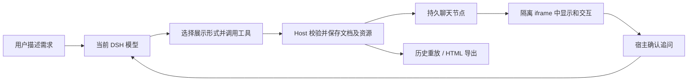

<div align="center">

# DSH Intelligent UI

**让 AI 的回答成为你可以操作的界面。**

在 DeepSeek Harness 对话中生成计算器、交互图表、地图、原理演示和小型应用。<br />
从一句自然语言开始，完成「生成 → 交互 → 保存重放 → 追问」。

[](LICENSE)
[](#兼容性)
[](#快速开始)
[](docs/architecture.md)
[](#独立-mcp)

**中文** · [English](README.en.md)

[快速开始](#快速开始) · [使用示例](#在对话中使用) · [工具清单](#工具清单) · [高德地图](#高德地图) · [开发文档](#开发与贡献)

</div>

---

## 为什么使用它

有些问题，需要亲手调节参数、比较选项，或看一遍过程。

DSH Intelligent UI 为这些问题提供交互式呈现。你描述目标，当前 DSH 模型调用工具生成界面，插件负责校验、显示和保存。界面中的按钮还可以携带当前参数，经过你的确认后，将问题送回原会话继续讨论。


| 想做什么 | 可以生成什么 | 试着这样说 |
| --- | --- | --- |
| 搞懂一个原理 | 带参数、动画与公式的演示 | “用可调摆长的单摆解释周期。” |
| 比较几种选择 | 对比卡片、评分或交互计算器 | “做一个三种方案的成本比较器。” |
| 展示一组数据 | 表格、柱状图、饼图、折线图 | “把这些数值画成图，注明单位和来源。” |
| 介绍地点或路线 | 地图、地点卡片、照片和行程播放 | “在地图上介绍某地的三个景点。” |
| 做一个小工具 | 表单控件、计算器、DOM/SVG/Canvas 应用 | “生成一个可以直接操作的单位换算器。” |
| 收集选择、展示进度 | 会议时间选择、只读工作流 | “让我从这三个会议时间中选择一个。” |

## 核心能力

- **在聊天里直接操作**：支持 HTML、CSS、JavaScript，以及 DOM、SVG、Canvas。生成过程中先显示静态预览，工具成功后再启用交互。
- **结果持续显示**：使用独立的聊天结果节点，保留工具返回的界面；支持历史重放、重置和单文件 HTML 导出。
- **界面跟随宿主**：适配 DSH 浅色/深色、字号和字体，内容自动测高，并显示可捕获的脚本运行错误。
- **常用组件开箱可用**：六种模板、结构化文本表格、内置 Chart.js 4.5.1 和 Leaflet 1.9.4，无需生成代码加载 CDN。
- **高德地图接入**：支持高德地点搜索与官方静态底图，保留地点标记、选点、缩放、平移和行程播放；Key 只在 Host 侧使用。
- **资源可追溯**：保留原有 OpenFreeMap 与百科/Commons 图片模式，展示地点来源和图片署名；个别地点无法定位时明确提示，其余已确认地点继续显示。
- **交互回到原会话**：追问经用户确认后提交，区分“等待确认”“已入队”和模型的运行、完成、失败或取消状态。
- **也能独立作为 MCP 使用**：复用文档校验、模板和 HTML 装配；适合需要自行接入渲染容器的客户端。

## 快速开始

### 兼容性

| 项目 | 当前要求与范围 |
| --- | --- |
| 插件版本 | `1.2.1` |
| DSH 宿主 | **`0.2.1-rc.2`** |
| 已验证的客户端路径 | Windows 发行版 CLI 启动的独立 **Web profile** |
| Node.js | **22.19+**；当前本地验证使用 Node 24 |
| 辅助启动脚本 | PowerShell 7，自动发现 Windows 发行版 CLI |
| 模型 | 在 DSH 中配置，需能使用工具 |
| DSH 源码 | 普通构建不需要；内部 Conversation 投影测试需要匹配标签源码 |


### 1. 获取并构建

```sh
git clone https://github.com/NingTiAn-byte/dsh-intelligent-ui.git
cd dsh-intelligent-ui
npm ci
npm run build
npm run check
```

构建使用锁文件中的 rc.2 SDK，不再依赖 alpha.4 源码链接。`lib/`、`dist/` 和预览页面都是生成产物；从 Git 获取源码后需要先构建。

### 2. 离线预览

```sh
npm run preview
```

这会生成并打开本地演示页面，无需配置模型。你可以检查控件、计算、重置与追问确认；预览中的追问只记录演示请求，不会发送到 DSH。

在无图形环境中只生成页面并打印位置：

```sh
npm run preview -- --no-open
```

### 3. 在发行版 DSH 中启动

确认已安装 DSH `0.2.1-rc.2`，在项目目录执行：

```powershell
pwsh -NoProfile -File scripts/run-dsh.ps1
```

脚本会构建插件、创建独立 `intelligent-ui` Web profile、通过官方插件管理器安装本地目录，然后启动并打开浏览器。默认端口为 `3098`；未设置 `DSH_HOME` 时，配置和会话放在项目的 `artifacts/dsh-home` 下。

在新打开的 DSH 中配置模型服务，再发送下面的测试提示词。独立 profile 不会自动复制你日常客户端的模型配置和凭据。

<details>
<summary><strong>自定义启动路径、端口与配置检查</strong></summary>

```powershell
# 端口已占用时
pwsh -NoProfile -File scripts/run-dsh.ps1 -Port 3099

# 只安装并检查合成配置，不启动服务
pwsh -NoProfile -File scripts/run-dsh.ps1 -Check

# 不自动打开浏览器
pwsh -NoProfile -File scripts/run-dsh.ps1 -NoOpen

# 自定义发行版官方 CLI 的位置
pwsh -NoProfile -File scripts/run-dsh.ps1 -DshCli '~\DeepSeek Harness\resources\runtime\cli\bin\dsh.cmd'
```

也可通过 `DSH_CLI` 指定官方启动器，通过 `DSH_HOME` 指定数据目录，通过 `-Profile` 指定 profile 名称。脚本会检查宿主版本，遇到不匹配时停止。

若要装入已有 profile，请使用该客户端的插件管理入口或官方 `dsh plugin --profile <name> add <本地项目目录>`，并确保使用同一个 `DSH_HOME` 和官方 CLI。上面的独立实例启动成功，不代表默认桌面 profile 已安装；桌面壳内的完整交互需另行验收。

</details>

## 在对话中使用

描述你需要的界面即可；为了首次确认工具链，建议明确要求调用工具。

### 第一个交互界面

```text
我想知道FFT算法的可视化表达是什么样的。
```

**预期结果：** 在 DSH 对话中生成可交互的 FFT 原理演示。若希望调节采样点数、输入信号或逐步观察计算过程，可以在提示词中补充这些要求；具体交互取决于模型生成的界面。

### 更多可复制的提示词

<details>
<summary><strong>原理演示：单摆</strong></summary>

```text
生成一个交互式单摆演示，可以调节摆长和重力加速度。
提供开始、暂停和重置，展示周期公式、参数单位与理想模型假设。
```

</details>

<details>
<summary><strong>数据图表：有单位、有来源</strong></summary>

```text
用柱状图比较 A、B、C 三种方案的耗时：12、18、9 分钟。
数据来源注明“用户提供的演示数据”，保留可读的数据表。
```

</details>

<details>
<summary><strong>地理介绍：高德地点与行程播放</strong></summary>

```text
使用高德地图介绍上海的外滩、武康路、陆家嘴，城市指定上海。
按地点名称查询，提供地点卡片、选点和行程播放，并保留来源链接。
```

需先按[高德地图](#高德地图)配置 Web服务 Key。高德底图是固定区域快照，放大不会加载新瓦片，站点连线不是道路导航；该模式不自动请求百科照片。原有 OpenFreeMap 模式仍可配合百科/Commons 图片使用。

首次准备地图需要联网。个别地点缺少可验证坐标时，会列入“尚未定位”提示，其余地点继续显示；所有地点均无法定位时才返回定位失败。底图下载、权限或配额错误会报告具体原因。

</details>

<details>
<summary><strong>交互小应用：小游戏</strong></summary>

```text
生成一个复古风格的打砖块小游戏，支持键盘操作。
提供开始、暂停、重新开始、分数和操作说明。
```

复杂游戏和科学模拟仍需实际操作确认逻辑正确性。

</details>

### 如何验证主线

1. **模型调用工具**：检查轨迹；默认先选择展示形式，再调用 UI、表格或专项工具。
2. **显示交互界面**：确认出现卡片并能操作，而不只是模型声称“已生成”。
3. **保存与重放**：等待本轮结束，刷新并重新打开同一会话，确认保存的界面仍可渲染。
4. **追问回到会话**：在界面内发起追问，在宿主确认后，检查当前会话收到消息及模型回复。

保存的是界面文档和资源，**不保证保留滑块位置、游戏分数等临时运行状态**。重置或重新挂载会重新运行界面。导出的 HTML 可独立交互，但不能直接向 DSH 发送追问。

## 工具清单

默认 `routing: model` 时注册 **11 个工具**。关闭展示路由后为 10 个；模型在某一阶段能看到的渲染工具还会随当前展示选择变化。

| 工具 | 作用 |
| --- | --- |
| `select_intelligent_ui_presentation` | 为当前用户消息选择 `text`、`table`、`ui` 或 `mixed`；由当前模型决定，无独立分类服务 |
| `render_intelligent_ui` | 生成通用交互界面，分别提供 HTML、CSS 和 JavaScript |
| `get_intelligent_ui_template` | 获取 `calculator`、`comparison`、`flowchart`、`chart_line`、`chart_bar`、`chart_pie` 模板 |
| `render_intelligent_table` | 展示只读文本表格，最多 12 列、200 行 |
| `render_intelligent_chart` | 通过结构化参数生成柱状图或饼图，附单位、来源与数据表 |
| `render_intelligent_map` | 按配置使用高德底图快照或原有 OpenFreeMap 模式，展示地点、卡片和行程播放 |
| `lookup_intelligent_ui_places` | 高德模式按名称与城市查询 POI，返回 GCJ-02 坐标；原有模式查询百科坐标，均保留来源 |
| `search_intelligent_ui_images` | 搜索 Commons 图片文件名与署名，最多返回 4 项 |
| `plan_intelligent_ui` | 展示可视化方案、技术选择和关键元素 |
| `render_intelligent_workflow` | 展示只读任务状态快照，不执行或推进任务 |
| `choose_intelligent_meeting_time` | 通过 DSH 人工问答选择会议时间，不创建预约 |

展示路由是同一个会话模型的一次工具选择。需要 UI 时，先完成选择，再在后续模型步骤调用渲染工具；不需要可视化的问题可以直接用文字回答。

注册实现：[Host 入口](src/index.ts) · [专项工具](src/host/features.ts) · [展示路由](src/host/routing.ts)。

## 工作原理



Host 管理工具、资源获取和文档校验；Client 管理聊天节点、iframe、主题和消息桥接；DSH 继续管理模型、会话、队列与人工问答。界面资源保存在工具结果 metadata 中，重放时无需重新让模型生成整份界面。

生成代码在独立来源、`sandbox="allow-scripts"` 的 iframe 内运行。流式阶段不执行生成脚本；成功后启用脚本。追问和外链经受限桥接交给宿主确认。

工具失败时，卡片会显示可用的具体错误文本，历史重放也保留该错误；失败或中断的预览不会启用脚本。

### 界面与会话桥接

```javascript
try {
  const receipt = await window.dshUI.sendPrompt('请解释当前参数对应的结果');
  // 这里只代表确认/入队结果，不代表模型已经回复。
} catch (error) {
  // 处理用户取消或提交失败。
}

const unsubscribe = window.dshUI.onRunStatus(event => {
  // 按 requestId 关联；completed 表示对应模型轮次完成。
  console.log(event.requestId, event.status);
});
```

还提供主题订阅、外链确认与错误报告。完整字段、版本和边界见 [运行契约](docs/runtime.md)。

## 配置

### 高德地图

高德模式使用 **Web服务 Key**：Host 调用地点搜索、坐标转换和官方静态地图接口，Leaflet 负责聊天卡片中的显示和交互。不需要申请 Web端（JS API）Key；当前实现也不是高德 JS 动态瓦片地图。

1. 在高德控制台为应用申请 **Web服务** Key。
2. 在插件根目录创建 `.env`，写入 `DSH_AMAP_KEY=你的高德Web服务Key`。默认自动读取该文件，与 DSH 的启动目录无关；修改后重启 DSH。也可用 `amapEnvFile` 指定其他 `.env` 路径。
3. 复制 [amap.example.yml](preview/amap.example.yml) 为 `preview/amap.local.yml`，填入真实文件路径：

```yaml
- id: intelligent-ui
  config:
    mapProvider: amap
    # amapEnvFile: 'D:/keys/.env' # Optional; defaults to the plugin root .env
    amapTimeoutMs: 15000
```

4. 用覆盖层启动独立 Web profile：

```powershell
pwsh -NoProfile -File scripts/run-dsh.ps1 -ImageNetworkPatch preview/amap.local.yml
```

已有客户端应将相同配置应用到其实际使用的 profile，然后完全退出并重启。不要通过 CLI 直接启动保留的 `desktop` profile，它由 Electron 客户端管理。

Key 不进入生成界面、工具结果或导出的 HTML；也不要将密钥文件提交 Git。`preview/amap.local.yml` 已被忽略，但放在其他位置的密钥文件需要自行排除。

| 行为 | 高德模式 | 原有模式 |
| --- | --- | --- |
| 配置 | `mapProvider: amap`，需要 Web服务 Key | `mapProvider: openfreemap`，默认值 |
| 地点查询 | 按名称与城市搜索高德 POI，显示实际匹配名称与来源 | 精确百科条目与中英文关联回退 |
| 底图 | 高德官方固定区域图片快照 | 下载并保存有界街道矢量数据 |
| 坐标 | 使用 GCJ-02；显式 WGS84 输入通过官方接口转换 | 使用 WGS84 |
| 自动照片 | 不自动请求海外百科照片；显式图片请求仍走独立管线 | 可自动查询百科/Commons 配图，最多四张 |
| 重放 | 重用保存的底图图片与文档 | 重用保存的几何与文档 |

调用地图工具时建议提供 `city`。显式坐标输入的 `coordinateSystem` 默认为 `wgs84`；若已有高德坐标，应声明 `gcj02`，避免重复转换。请求有节流和有限重试，权限、配额和网络错误仍会明确报告。未配置高德的 profile 不会自动切换，旧历史文档也不会被改写。

### 通用参数

通过 DSH profile 的插件配置或额外 patch 覆盖参数。仓库的 [默认 patch](cordis.patch.yml) 定义插件入口；下面的覆盖层可配合启动脚本 `-ImageNetworkPatch` 使用，该参数实际上接收通用的额外 patch 文件。

```yaml
- id: intelligent-ui
  config:
    maxDocumentChars: 200000
    minHeight: 180
    maxHeight: 900
    routing: model
    imagesEnabled: true
    imageMaxBytes: 256000
    imageTimeoutMs: 15000
    imageProxyUrl: ''
    mapCacheDir: ''
    mapProvider: openfreemap
    amapEnvFile: ''
    amapKeyFile: ''
    amapTimeoutMs: 15000
```

| 参数 | 作用 |
| --- | --- |
| `maxDocumentChars` | HTML、CSS、JavaScript 总字符上限，可设为 1000～200000 |
| `minHeight` / `maxHeight` | 初始高度边界，均在 180～900 px 内，最小值不能大于最大值 |
| `routing` | `model` 为默认展示路由；`off` 关闭路由限制 |
| `imagesEnabled` | 控制 Host 图片获取；不等同于关闭全部网络或地图下载 |
| `imageMaxBytes` / `imageTimeoutMs` | 每张图片默认字节上限及相关请求超时 |
| `imageProxyUrl` | 原有图片、百科和 OpenFreeMap 请求的可选代理；不控制高德请求，不要提交含凭据的配置 |
| `mapCacheDir` | OpenFreeMap 模式的可选街道缓存目录；高德不使用此缓存 |
| `mapProvider` | `openfreemap`（默认）或 `amap`；高德模式统一使用高德底图快照 |
| `amapEnvFile` | 默认读取插件根目录 `.env`；可指定其他文件路径，读取 `DSH_AMAP_KEY` |
| `amapKeyFile` | 兼容旧版的纯 Key 文件；优先级：进程环境变量 → `.env` → 旧版 Key 文件。`.env` 不会写入全局环境变量，也不要提交真实密钥 |
| `amapTimeoutMs` | 高德每次网络请求超时，默认 15000 ms，可设 1000～60000 ms；不包含节流等待 |

初始高度与自动内容测高是两个概念，自动测高支持 180～4000 px。完整配置定义见 [src/index.ts](src/index.ts)。

## 独立 MCP

MCP 版提供 **13 个资源、3 个提示和 7 个工具**。它返回装配后的 HTML 与结构化文档；是否显示成界面，由接入的 MCP 客户端决定。

| 能力 | DSH 插件 | 独立 MCP |
| --- | --- | --- |
| 文档校验、模板、HTML 装配 | 支持 | 支持 |
| 持久聊天节点与原会话追问 | DSH Client 提供 | 需客户端自行实现渲染与确认桥接 |
| 地名解析与百科图片获取 | Host 提供 | 未提供相同能力 |
| 结构化地图 | 支持地名或坐标 | 需提供坐标；街道准备仍可能联网 |
| 高德地点搜索与底图 | 支持，需配置 Web服务 Key | 当前未接入高德，仍使用原有模式 |
| 会议时间人工选择 | 复用 DSH 人工问答 | 未提供 |
| 运行环境 | DSH rc.2 | Node.js，无需 DSH |

```sh
npm run build
npm run verify:mcp
npm run mcp
```

使用构建生成的 `preview/mcp.config.json`，或将以下示例中的路径替换为实际绝对路径：

```json
{
  "mcpServers": {
    "dsh-intelligent-ui": {
      "command": "node",
      "args": ["/absolute/path/to/dsh-intelligent-ui/lib/mcp-stdio.js"]
    }
  }
}
```

MCP 工具为 `assemble_document`、`assemble_saved_document`、`get_intelligent_ui_template`、`render_intelligent_chart`、`render_intelligent_map`、`plan_intelligent_ui`、`render_intelligent_workflow`。它们与 DSH 的工具集合不同。

需要复制到另一台机器时，可复制整个 `dist/mcp`，在目标目录执行 `npm install --ignore-scripts`，再运行 `node mcp-stdio.js`。本机配置文件含绝对路径，被 Git 忽略。


## 运行边界

- 生成脚本不能直接操作宿主 DOM、加载任意远程脚本或随意发起网络请求；外部资源由受控 Host 能力处理。
- 保存的文档与资源可重放；首次图片/街道获取仍需联网，旧 NASA/USGS 模式可能使用固定来源远程图块。
- 高德是固定区域底图快照，放大不会增加细节；所有模式的行程连线都是顺序直线，不代表道路规划。
- 原生表格是只读文本表格，没有内置排序、筛选和分页；需要这些交互时使用通用 UI 工具。
- 会议选择不创建日历预约，工作流展示不执行任务，插件不自带业务数据库。
- 可捕获运行错误不等于能恢复死循环或浏览器崩溃。生成游戏、计算逻辑和科学模拟需要核对正确性。

## 开发与贡献

```text
src/
├── index.ts       # Host 入口、配置与通用工具
├── host/          # 地点、图片、地图、展示路由、追问关联
├── client/        # 聊天节点、iframe、桥接与主题
├── shared/        # 文档协议、校验、模板与组件
└── mcp/           # 独立 stdio MCP 服务
preview/           # 离线演示与浏览器测试页面
scripts/           # 构建、检查、启动与验证
tests/             # 单元、Host 集成及真实浏览器测试
vendor/            # 固定版本第三方资源与许可
```

| 命令 | 用途 |
| --- | --- |
| `npm run build` | 构建 Host、Client、预览及 MCP 独立包，校验 vendor 哈希 |
| `npm run check` | Host、Client、MCP 严格 TypeScript 检查 |
| `npm test` | 单元、集成和浏览器测试；内部投影项需匹配标签源码 |
| `npm run verify:mcp` | 使用真实 stdio 客户端验证 MCP 握手、资源、提示与工具 |
| `npm run audit:release` | 检查待发布文件中的本地产物、已识别密钥与个人路径 |

浏览器测试优先使用 `DSH_TEST_BROWSER`；Windows 自动发现 Edge，否则需要 `npx playwright install chromium`。默认回归使用受控测试，不调用真实模型；真实模型端到端体验与联网资源需要另行检查。

欢迎通过 [Issue](https://github.com/NingTiAn-byte/dsh-intelligent-ui/issues) 提交可复现问题，或通过 Pull Request 改进模板、兼容性和文档。报告时附上 DSH/插件版本、profile 类型、复现提示词、工具轨迹与已脱敏日志；不要提交密钥、带访问令牌的 URL 或私人会话。


## 许可与致谢

本项目采用 [MIT License](LICENSE)。依赖的 Chart.js、Leaflet、图片与地图数据保留各自许可和署名，详见 [第三方说明](THIRD_PARTY_NOTICES.md) 与 [地图测试数据署名](tests/fixtures/MAP-DATA-NOTICE.md)。

感谢 [DeepSeek Harness](https://github.com/deepseek-ai/deepseek-harness)、[Model Context Protocol](https://github.com/modelcontextprotocol)、[Chart.js](https://github.com/chartjs/Chart.js) 与 [Leaflet](https://github.com/Leaflet/Leaflet) 提供的基础能力。
